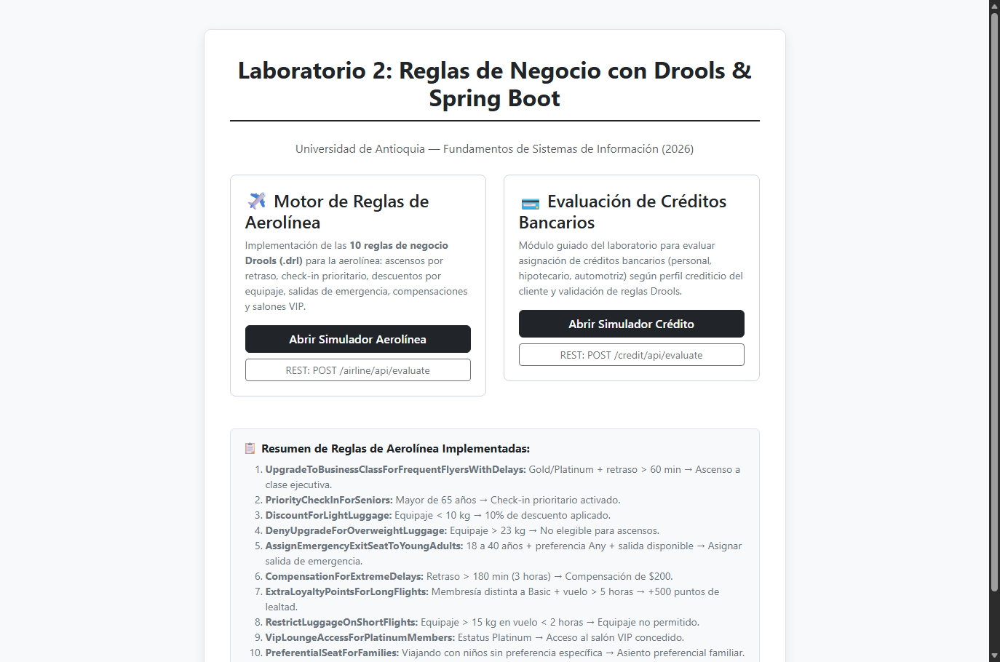
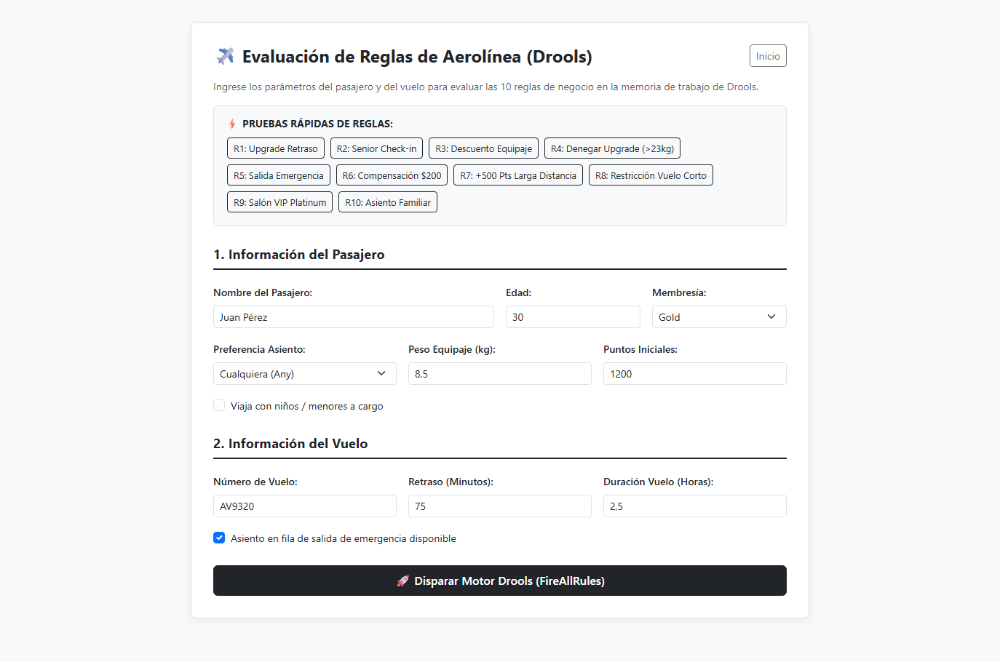
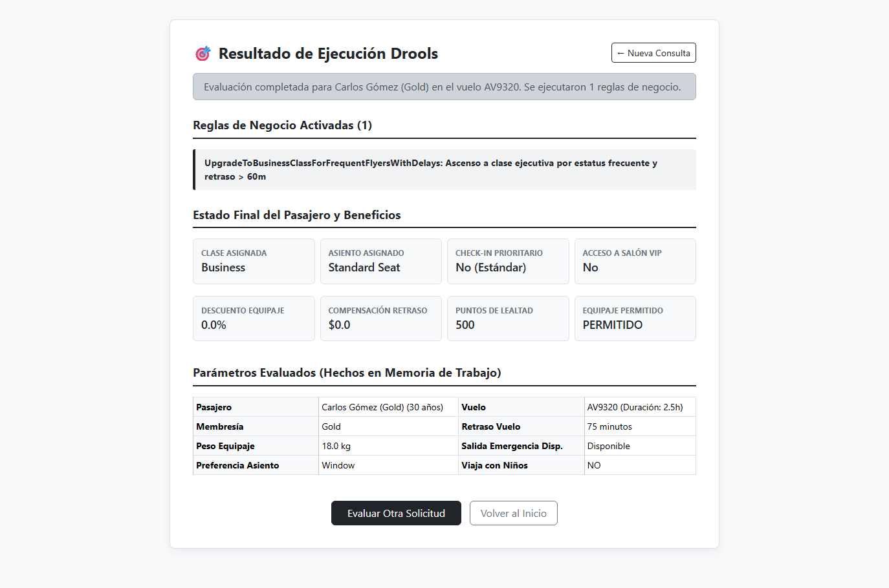
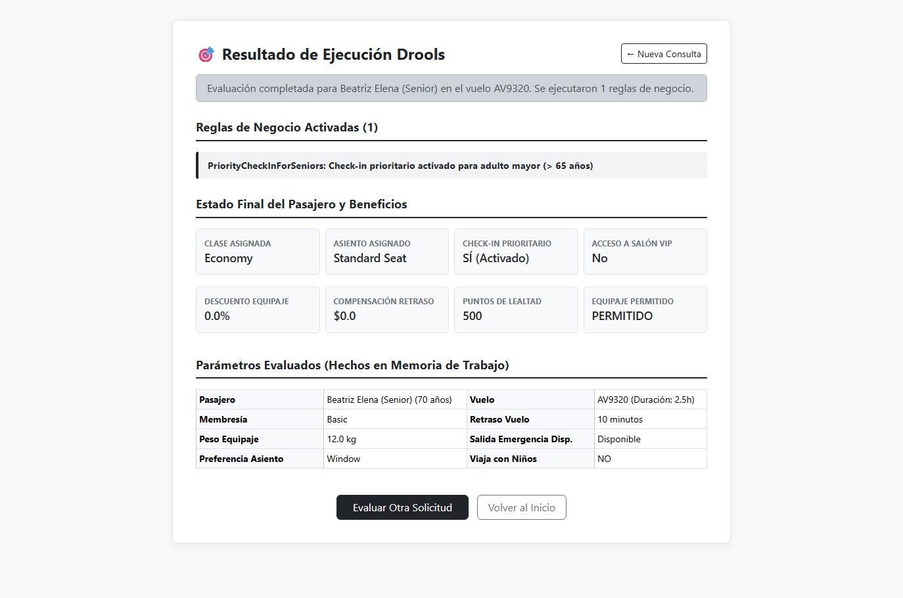
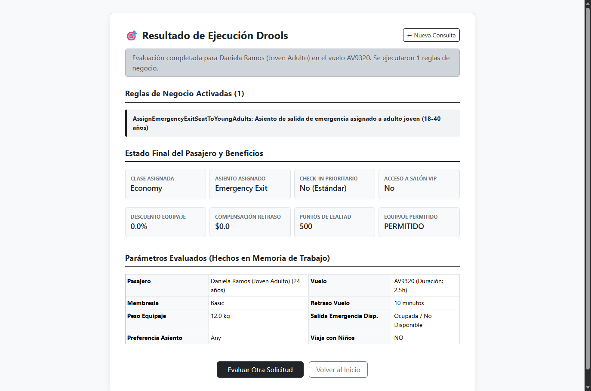
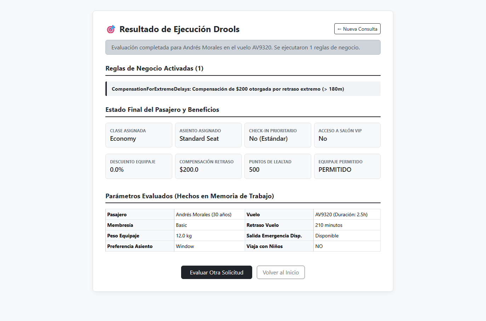
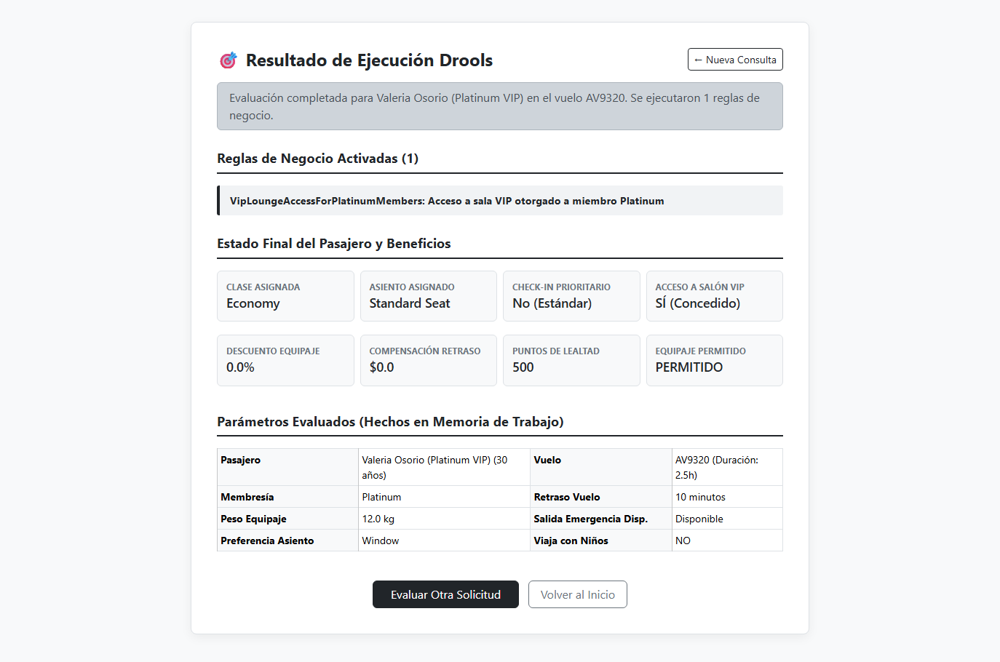
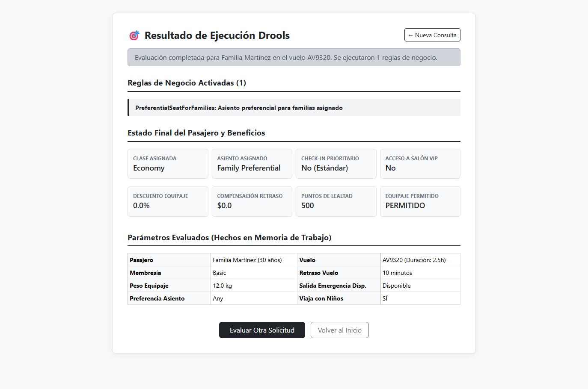
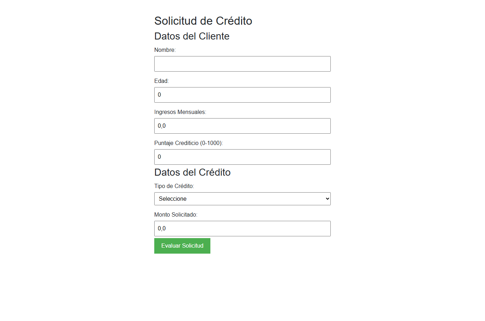
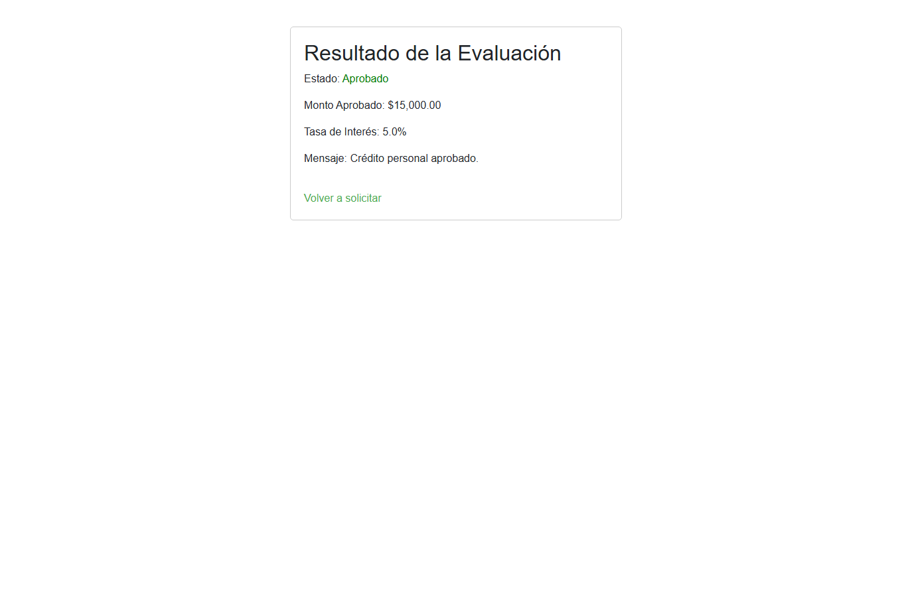

# INFORME DE LABORATORIO N° 2
# REGLAS DEL NEGOCIO CON SPRING BOOT Y DROOLS (BRMS)

**Universidad de Antioquia**  
**Facultad de Ingeniería — Departamento de Ingeniería de Sistemas**  
**Curso:** Fundamentos de Sistemas de Información (2026)  
**Profesor:** Diego Botia  
**Estudiante:** Santiago Jaramillo  
**Fecha:** Octubre de 2026  
**Repositorio GitHub:** [https://github.com/Santiagox01/lab2-fsi](https://github.com/Santiagox01/lab2-fsi)  
**Repositorio Guía Docente:** [https://github.com/diegobotia/droolsrules](https://github.com/diegobotia/droolsrules)

---

## 1. RESUMEN EJECUTIVO

El presente informe documenta la investigación, diseño, desarrollo y validación experimental del **Laboratorio N° 2**, centrado en la integración del motor de reglas de negocio **Drools** con el ecosistema **Spring Boot 3** en **Java 21**. 

Los Sistemas de Administración de Reglas de Negocio (**BRMS** - *Business Rules Management Systems*) representan un cambio de paradigma frente a la programación imperativa convencional, al permitir que la lógica de decisión corporativa se externalice en artefactos declarativos (`.drl`), desacoplándola del flujo procedimental del código de la aplicación. 

En este trabajo se construyó una solución robusta y completa que abarca:
1. **El Motor de Reglas de Aerolínea (Ejercicio Principal):** Implementación de las **10 reglas de negocio** solicitadas en la guía oficial para la asignación dinámica de ascensos a clase ejecutiva, check-in prioritario para adultos mayores, descuentos en tarifas por equipaje ligero, penalizaciones por exceso de peso, asignación de salidas de emergencia a adultos jóvenes, compensaciones económicas por retrasos severos, acreditación de puntos de lealtad, restricciones de equipaje en vuelos cortos, pases a salones VIP y asignación preferencial de asientos para grupos familiares.
2. **El Sistema de Evaluación de Créditos Bancarios (Módulo Tutorial):** Implementación integral del servicio de evaluación de riesgo crediticio (personal, hipotecario y automotriz) con validación mediante Jakarta Validation y ejecución de 6 reglas Drools.
3. **Mecanismo de Interacción Dual:** Exposición de servicios mediante **API REST (JSON)** y una **Interfaz Web Interactiva (Thymeleaf con Bootstrap 5)** que incluye botones de prueba rápida (*presets*) para evaluar cada regla en tiempo real.
4. **Verificación Automatizada Exhaustiva:** Creación de una suite de **21 pruebas unitarias automáticas con JUnit 5**, alcanzando una tasa de éxito del 100% (0 errores, 0 fallos).
5. **Resolución de Compatibilidad Java 21:** Diagnóstico y resolución del conflicto histórico entre versiones anteriores de Drools/MVEL y la eliminación de la clase `java.lang.Compiler` en Java 21, logrando una compilación nativa y limpia mediante la actualización controlada de dependencias (`mvel2 2.5.2.Final`).

---

## 2. INTRODUCCIÓN Y FUNDAMENTOS TEÓRICOS

### 2.1. El Concepto de BRMS (Business Rules Management System)
En el desarrollo de software empresarial convencional, la lógica de negocio suele codificarse mediante estructuras condicionales anidadas (`if-else`, `switch-case`) dispersas a lo largo de las capas de servicio y controladores. Este enfoque monolítico introduce graves desventajas:
- **Alta rigidez:** Cualquier cambio en una política de precios, descuentos o elegibilidad exige recompilar, probar y redesplegar toda la aplicación.
- **Dificultad de mantenimiento:** A medida que crecen las excepciones de negocio, el código se vuelve frágil, propenso a errores colaterales y difícil de auditar.
- **Brecha de comunicación:** Los expertos del dominio de negocio (analistas, administradores) no pueden leer ni validar directamente el código fuente.

Un **BRMS** desacopla las reglas del negocio de la arquitectura de la aplicación. Las reglas se definen en un lenguaje específico del dominio (**DRL** - *Drools Rule Language*), permitiendo que la lógica sea declarativa, atómica y comprensible tanto para desarrolladores como para analistas.

### 2.2. El Algoritmo Rete y el Motor Drools
Drools opera sobre una adaptación orientada a objetos del **algoritmo Rete**, propuesto originalmente por Charles Forgy en 1974. En lugar de evaluar secuencialmente cada regla contra cada objeto (lo cual tendría una complejidad computacional ineficiente de orden cuadrático o cúbico), Rete construye una red dirigida y acíclica de nodos en memoria:
- **Nodos Raíz (Type Nodes):** Filtran los hechos por tipo de clase Java.
- **Nodos Alpha (Alpha Nodes):** Evalúan condiciones sobre campos individuales de un único hecho (ej. `age > 65`, `luggageWeight < 10.0`).
- **Nodos Beta (Beta Nodes):** Evalúan relaciones cruzadas entre múltiples hechos (ej. vincular un hecho `Passenger` con un hecho `Flight`).
- **Nodos Terminales (Terminal Nodes):** Representan la activación de una regla lista para ser disparada en la **Agenda**.

Cuando un hecho se inserta o modifica en la memoria de trabajo (*Working Memory*), este se propaga únicamente a través de las ramas afectadas de la red Rete, garantizando tiempos de respuesta casi instantáneos incluso ante grandes volúmenes de datos.

### 2.3. Componentes Principales de la Arquitectura KIE (Knowledge Is Everything)
1. **KieServices:** Punto de acceso central singleton a todas las utilidades de KIE.
2. **KieFileSystem:** Sistema de archivos virtual en memoria donde se registran las definiciones `.drl`.
3. **KieBuilder:** Compilador interno responsable de validar la sintaxis DRL y construir el modelo ejecutable.
4. **KieModule:** Contenedor de los artefactos de conocimiento compilados.
5. **KieContainer:** Fábrica encargada de instanciar sesiones de conocimiento basadas en la base de reglas compilada.
6. **KieSession:** Entorno de ejecución en el cual se insertan los hechos (`insert`), se ejecutan las reglas (`fireAllRules`) y se libera la memoria (`dispose`).

---

## 3. ARQUITECTURA TÉCNICA E IMPLEMENTACIÓN DEL SISTEMA

### 3.1. Estructura General del Proyecto
El proyecto se organizó bajo la convención estándar de Maven y Spring Boot, estructurado en paquetes limpios según responsabilidades:

```
lab2-fsi/
├── pom.xml                                      # Configuración de dependencias Spring Boot 3 + Drools 7 + MVEL 2
├── src/
│   ├── main/
│   │   ├── java/com/udea/droolrules/
│   │   │   ├── DroolrulesApplication.java       # Clase principal de arranque Spring Boot
│   │   │   ├── config/
│   │   │   │   └── DroolsConfig.java            # Configuración y Bean del KieContainer
│   │   │   ├── controller/
│   │   │   │   ├── AirlineController.java       # Controlador web y REST del módulo de aerolínea
│   │   │   │   ├── CreditEvaluationController.java # Controlador web y REST del módulo de crédito
│   │   │   │   └── HomeController.java          # Controlador del portal de bienvenida
│   │   │   ├── model/
│   │   │   │   ├── AirlineEvaluationRequest.java # DTO de entrada para la API de aerolínea
│   │   │   │   ├── AirlineEvaluationResponse.java # DTO de salida con trazabilidad de reglas
│   │   │   │   ├── Customer.java                # Hecho del cliente bancario con validaciones
│   │   │   │   ├── CreditRequest.java           # Solicitud de crédito
│   │   │   │   ├── CreditResponse.java          # Resultado crediticio calculado
│   │   │   │   ├── Flight.java                  # Hecho del vuelo (número, retraso, duración, salida emergencia)
│   │   │   │   └── Passenger.java               # Hecho del pasajero (edad, estatus, equipaje, asiento, clase)
│   │   │   └── service/
│   │   │       ├── AirlineEvaluationService.java # Servicio de orquestación de sesión Drools de aerolínea
│   │   │       └── CreditEvaluationService.java  # Servicio de orquestación de sesión Drools de crédito
│   │   └── resources/
│   │       ├── application.properties           # Propiedades de servidor y configuración
│   │       ├── rules/
│   │       │   ├── airline_rules.drl            # Definición formal de las 10 reglas de la aerolínea
│   │       │   └── credit_rules.drl             # Definición formal de las 6 reglas crediticias
│   │       └── templates/
│   │           ├── index.html                   # Portal de inicio para navegar entre módulos
│   │           ├── airline_form.html            # Formulario interactivo de aerolínea con 10 presets
│   │           ├── airline_result.html          # Vista de resultados y desglose de hechos
│   │           ├── credit_form.html             # Formulario de crédito bancario
│   │           └── credit_result.html           # Vista de resultados crediticios
│   └── test/java/com/udea/droolrules/
│       ├── AirlineRulesTest.java                # 11 Pruebas unitarias para las reglas de aerolínea
│       ├── CreditRulesTest.java                 # 9 Pruebas unitarias para las reglas crediticias
│       └── DroolrulesApplicationTests.java      # Prueba de verificación de carga del contexto Spring
```

### 3.2. Configuración del Motor Drools (`DroolsConfig.java`)
Para permitir que la aplicación ejecute dinámicamente ambos dominios de reglas sin colisiones, la clase `DroolsConfig` compila en el mismo contenedor virtual tanto `credit_rules.drl` como `airline_rules.drl`:

```java
@Configuration
public class DroolsConfig {

    private static final KieServices kieServices = KieServices.Factory.get();
    private static final String RULES_CREDIT_RULES_DRL = "rules/credit_rules.drl";
    private static final String RULES_AIRLINE_RULES_DRL = "rules/airline_rules.drl";

    @Bean
    public KieContainer kieContainer() {
        KieFileSystem kieFileSystem = kieServices.newKieFileSystem();
        kieFileSystem.write(ResourceFactory.newClassPathResource(RULES_CREDIT_RULES_DRL));
        kieFileSystem.write(ResourceFactory.newClassPathResource(RULES_AIRLINE_RULES_DRL));
        KieBuilder kb = kieServices.newKieBuilder(kieFileSystem);
        kb.buildAll();
        KieModule kieModule = kb.getKieModule();
        return kieServices.newKieContainer(kieModule.getReleaseId());
    }
}
```

---

## 4. IMPLEMENTACIÓN DE LAS 10 REGLAS DE NEGOCIO DE LA AEROLÍNEA

A continuación se detalla cada una de las 10 reglas programadas en `src/main/resources/rules/airline_rules.drl`, explicando su propósito de negocio, condiciones (*When / LHS*), consecuencias (*Then / RHS*) y estrategias de control de agenda (*Salience* y modificación de hechos en memoria de trabajo).

### Regla 1: Upgrade a Clase Ejecutiva por Estatus Frecuente y Retraso
- **Identificador DRL:** `UpgradeToBusinessClassForFrequentFlyersWithDelays`
- **Condición:** Pasajero con membresía "Gold" o "Platinum", que se encuentre habilitado para ascensos (`upgradeEligible == true`), que no esté ya en Business, y que aborde un vuelo con más de 60 minutos de retraso (`delayMinutes > 60`).
- **Acción:** Ascenso a clase ejecutiva (`assignedClass = "Business"`) y registro de la regla en el historial del pasajero.
- **Salience:** 20 (se evalúa tras validar posibles penalizaciones de equipaje).

```drools
rule "UpgradeToBusinessClassForFrequentFlyersWithDelays"
    salience 20
    when
        $p : Passenger(membershipStatus in ("Gold", "Platinum"), upgradeEligible == true, assignedClass != "Business")
        $f : Flight(delayMinutes > 60)
    then
        $p.setAssignedClass("Business");
        $p.getAppliedRules().add("UpgradeToBusinessClassForFrequentFlyersWithDelays: Ascenso a clase ejecutiva por estatus frecuente y retraso > 60m");
end
```

### Regla 2: Check-in Prioritario para Adultos Mayores
- **Identificador DRL:** `PriorityCheckInForSeniors`
- **Condición:** Pasajero con edad estrictamente superior a 65 años (`age > 65`).
- **Acción:** Activa el indicador de check-in prioritario (`priorityCheckIn = true`).

```drools
rule "PriorityCheckInForSeniors"
    when
        $p : Passenger(age > 65, priorityCheckIn == false)
    then
        $p.setPriorityCheckIn(true);
        $p.getAppliedRules().add("PriorityCheckInForSeniors: Check-in prioritario activado para adulto mayor (> 65 años)");
end
```

### Regla 3: Descuento por Equipaje Ligero
- **Identificador DRL:** `DiscountForLightLuggage`
- **Condición:** Pasajero cuyo equipaje registrado pese estrictamente menos de 10 kg (`luggageWeight < 10.0`).
- **Acción:** Aplica un descuento del 10% en la tarifa (`discountPercentage = 10.0`).

```drools
rule "DiscountForLightLuggage"
    when
        $p : Passenger(luggageWeight < 10.0, discountPercentage < 10.0)
    then
        $p.setDiscountPercentage(10.0);
        $p.getAppliedRules().add("DiscountForLightLuggage: 10% de descuento por equipaje ligero (< 10kg)");
end
```

### Regla 4: Denegar Ascenso por Equipaje con Sobrepeso
- **Identificador DRL:** `DenyUpgradeForOverweightLuggage`
- **Condición:** Pasajero cuyo equipaje supere los 23 kg (`luggageWeight > 23.0`).
- **Acción:** Inhabilita al pasajero para ascensos (`upgradeEligible = false`). Emplea la directiva `modify($p)` de Drools para notificar inmediatamente a la red Rete sobre el cambio en el hecho, cancelando cualquier activación previa de ascenso a Business.
- **Salience:** 30 (prioridad más alta entre las reglas de asignación de clase).

```drools
rule "DenyUpgradeForOverweightLuggage"
    salience 30
    when
        $p : Passenger(luggageWeight > 23.0, upgradeEligible == true)
    then
        modify($p) {
            setUpgradeEligible(false)
        }
        $p.getAppliedRules().add("DenyUpgradeForOverweightLuggage: Equipaje > 23kg, no elegible para ascensos");
end
```

### Regla 5: Asignar Asiento de Salida de Emergencia a Adultos Jóvenes
- **Identificador DRL:** `AssignEmergencyExitSeatToYoungAdults`
- **Condición:** Pasajero con edad comprendida entre 18 y 40 años inclusive, con preferencia de asiento flexible (`seatPreference == "Any"`), que no viaje con niños, y en un vuelo con asiento de salida de emergencia disponible (`emergencyExitAvailable == true`).
- **Acción:** Asigna la salida de emergencia (`assignedSeat = "Emergency Exit"`) y marca la salida de emergencia como ocupada en el hecho del vuelo (`emergencyExitAvailable = false`).
- **Salience:** 10.

```drools
rule "AssignEmergencyExitSeatToYoungAdults"
    salience 10
    when
        $p : Passenger(age >= 18, age <= 40, seatPreference == "Any", travelingWithChildren == false, assignedSeat != "Emergency Exit")
        $f : Flight(emergencyExitAvailable == true)
    then
        $p.setAssignedSeat("Emergency Exit");
        $f.setEmergencyExitAvailable(false);
        $p.getAppliedRules().add("AssignEmergencyExitSeatToYoungAdults: Asiento de salida de emergencia asignado a adulto joven (18-40 años)");
end
```

### Regla 6: Compensación Económica por Retrasos Extremos
- **Identificador DRL:** `CompensationForExtremeDelays`
- **Condición:** Vuelo con retraso superior a 180 minutos (3 horas) (`delayMinutes > 180`).
- **Acción:** Concede una compensación económica de $200 USD directamente al pasajero (`compensationAmount = 200.0`).

```drools
rule "CompensationForExtremeDelays"
    when
        $p : Passenger(compensationAmount < 200.0)
        $f : Flight(delayMinutes > 180)
    then
        $p.setCompensationAmount(200.0);
        $p.getAppliedRules().add("CompensationForExtremeDelays: Compensación de $200 otorgada por retraso extremo (> 180m)");
end
```

### Regla 7: Puntos de Lealtad Adicionales por Vuelos de Larga Distancia
- **Identificador DRL:** `ExtraLoyaltyPointsForLongFlights`
- **Condición:** Pasajero con membresía activa no básica (`membershipStatus != null`, `membershipStatus != "Basic"`) en un vuelo con duración superior a 5 horas (`durationHours > 5.0`).
- **Acción:** Suma 500 puntos de lealtad a la cuenta del pasajero (`loyaltyPoints += 500`).

```drools
rule "ExtraLoyaltyPointsForLongFlights"
    when
        $p : Passenger(membershipStatus != null, membershipStatus != "Basic")
        $f : Flight(durationHours > 5.0)
    then
        $p.setLoyaltyPoints($p.getLoyaltyPoints() + 500);
        $p.getAppliedRules().add("ExtraLoyaltyPointsForLongFlights: 500 puntos de lealtad adicionales por vuelo de larga duración (> 5h)");
end
```

### Regla 8: Restringir Equipaje Pesado en Vuelos Cortos
- **Identificador DRL:** `RestrictLuggageOnShortFlights`
- **Condición:** Pasajero con equipaje superior a 15 kg (`luggageWeight > 15.0`) en un vuelo con duración inferior a 2 horas (`durationHours < 2.0`).
- **Acción:** Deniega el ingreso del equipaje en bodega para ese vuelo (`luggageAllowed = false`).

```drools
rule "RestrictLuggageOnShortFlights"
    when
        $p : Passenger(luggageWeight > 15.0, luggageAllowed == true)
        $f : Flight(durationHours < 2.0)
    then
        $p.setLuggageAllowed(false);
        $p.getAppliedRules().add("RestrictLuggageOnShortFlights: Equipaje > 15kg NO permitido en vuelo corto (< 2h)");
end
```

### Regla 9: Acceso al Salón VIP para Miembros Platinum
- **Identificador DRL:** `VipLoungeAccessForPlatinumMembers`
- **Condición:** Pasajero con categoría de viajero frecuente `"Platinum"` (`membershipStatus == "Platinum"`).
- **Acción:** Otorga pase de cortesía al salón VIP (`vipLoungeAccess = true`).

```drools
rule "VipLoungeAccessForPlatinumMembers"
    when
        $p : Passenger(membershipStatus == "Platinum", vipLoungeAccess == false)
    then
        $p.setVipLoungeAccess(true);
        $p.getAppliedRules().add("VipLoungeAccessForPlatinumMembers: Acceso a sala VIP otorgado a miembro Platinum");
end
```

### Regla 10: Asiento Preferencial para Grupos Familiares
- **Identificador DRL:** `PreferentialSeatForFamilies`
- **Condición:** Pasajero que viaja con niños (`travelingWithChildren == true`) y que no ha seleccionado una preferencia restrictiva de asiento (`seatPreference == null || seatPreference == "Any"`).
- **Acción:** Asigna automáticamente la zona preferencial para familias (`assignedSeat = "Family Preferential"`).
- **Salience:** 15 (se evalúa con prioridad superior a la regla de salida de emergencia para proteger normativas aeronáuticas que prohíben menores en salidas de emergencia).

```drools
rule "PreferentialSeatForFamilies"
    salience 15
    when
        $p : Passenger(travelingWithChildren == true, seatPreference == null || seatPreference == "Any")
    then
        $p.setAssignedSeat("Family Preferential");
        $p.getAppliedRules().add("PreferentialSeatForFamilies: Asiento preferencial para familias asignado");
end
```

---

## 5. RESOLUCIÓN DE COMPATIBILIDAD CRÍTICA: DROOLS 7 Y JAVA 21

Durante la fase de construcción del entorno de ejecución con Maven, se identificó un fallo crítico a nivel de máquina virtual originado por la arquitectura del compilador de expresiones de Drools:

### Diagnóstico del Error
```
Factory method 'kieContainer' threw exception with message: java/lang/Compiler
Caused by: java.lang.NoClassDefFoundError: java/lang/Compiler
```

### Causa Raíz
La clase `java.lang.Compiler` fue marcada como obsoleta (*deprecated for removal*) a partir de Java 9 y fue **completamente eliminada del JDK en Java 21**. Las versiones estándar de Drools 7.74.x incluyen internamente dependencias transitivas de `mvel2` anteriores a la versión `2.5.x`, las cuales mantenían referencias estáticas a dicha clase para optimizaciones de bytecode en tiempo de ejecución. Al ejecutarse sobre OpenJDK 21.0.8, la JVM arrojaba un error irrecuperable al instanciar el contenedor de reglas.

### Solución Implementada
Se resolvió forzando de manera explícita la dependencia de **`org.mvel:mvel2:2.5.2.Final`** en el archivo `pom.xml`. Esta versión elimina todo enlace con `java.lang.Compiler`, garantizando compatibilidad nativa con Java 21 LTS sin necesidad de degradar el compilador del sistema a Java 17 ni alterar la API pública de Drools:

```xml
<dependency>
    <groupId>org.drools</groupId>
    <artifactId>drools-mvel</artifactId>
    <version>${drools.version}</version>
</dependency>
<dependency>
    <groupId>org.mvel</groupId>
    <artifactId>mvel2</artifactId>
    <version>2.5.2.Final</version>
</dependency>
```

---

## 6. RESULTADOS EXPERIMENTALES Y PRUEBAS AUTOMATIZADAS

### 6.1. Matriz de Pruebas Unitarias Automatizadas (JUnit 5)
Para garantizar la fiabilidad formal del motor de reglas, se diseñaron 21 casos de prueba automatizados ejecutados mediante Maven Surefire Plugin:

| Clase de Prueba | Caso de Prueba | Parámetros de Entrada | Resultado Esperado | Estado |
|---|---|---|---|---|
| `AirlineRulesTest` | `testRule1_UpgradeToBusinessClass` | Gold, Retraso 75 min, Equipaje 18 kg | `assignedClass == "Business"` | **PASÓ** |
| `AirlineRulesTest` | `testRule2_PriorityCheckInForSeniors` | Edad 68 años | `priorityCheckIn == true` | **PASÓ** |
| `AirlineRulesTest` | `testRule3_DiscountForLightLuggage` | Equipaje 8.5 kg | `discountPercentage == 10.0%` | **PASÓ** |
| `AirlineRulesTest` | `testRule4_DenyUpgradeForOverweight` | Platinum, Retraso 90 min, Equipaje 26 kg | `upgradeEligible == false`, Clase Economy | **PASÓ** |
| `AirlineRulesTest` | `testRule5_AssignEmergencyExitSeat` | Edad 24 años, Asiento Any, Salida disponible | `assignedSeat == "Emergency Exit"` | **PASÓ** |
| `AirlineRulesTest` | `testRule6_CompensationForExtremeDelays` | Retraso 200 min | `compensationAmount == $200.0` | **PASÓ** |
| `AirlineRulesTest` | `testRule7_ExtraLoyaltyPoints` | Membresía Silver, Vuelo 6.5 horas | Puntos aumentan de 1000 a 1500 (+500) | **PASÓ** |
| `AirlineRulesTest` | `testRule8_RestrictLuggageOnShortFlights` | Equipaje 18 kg, Vuelo 1.2 horas | `luggageAllowed == false` | **PASÓ** |
| `AirlineRulesTest` | `testRule9_VipLoungeAccess` | Membresía Platinum | `vipLoungeAccess == true` | **PASÓ** |
| `AirlineRulesTest` | `testRule10_PreferentialSeatForFamilies` | Con niños, Asiento Any | `assignedSeat == "Family Preferential"` | **PASÓ** |
| `AirlineRulesTest` | `testCombinedScenario` | Senior 70, Platinum, Equipaje 8 kg, Retraso 210m, Vuelo 6h | Se activan 6 reglas en armonía | **PASÓ** |
| `CreditRulesTest` | `testPrueba1_RejectLowCreditScore` | Score 450 | Rechazado: Score bajo | **PASÓ** |
| `CreditRulesTest` | `testPrueba2_RejectUnderAge` | Edad 16 años | Rechazado: Menor de edad | **PASÓ** |
| `CreditRulesTest` | `testPrueba3_PersonalCredit_LowRate` | Score 750, Personal | Aprobado: Tasa 5.0% | **PASÓ** |
| `CreditRulesTest` | `testPrueba4_PersonalCredit_HighRate` | Score 600, Personal | Aprobado: Tasa 8.0%, Monto ajustado a 10x ingresos | **PASÓ** |
| `CreditRulesTest` | `testPrueba5_MortgageCredit_LowRate` | Score 800, Hipotecario | Aprobado: Tasa 3.5% | **PASÓ** |
| `CreditRulesTest` | `testPrueba6_MortgageCredit_HighRate` | Score 650, Hipotecario | Aprobado: Tasa 4.5%, Monto ajustado a 50x ingresos | **PASÓ** |
| `CreditRulesTest` | `testPrueba7_AutoCredit_LowRate` | Score 720, Automotriz | Aprobado: Tasa 6.0% | **PASÓ** |
| `CreditRulesTest` | `testPrueba8_AutoCredit_HighRate` | Score 600, Automotriz | Aprobado: Tasa 7.5%, Monto ajustado a 20x ingresos | **PASÓ** |
| `CreditRulesTest` | `testPrueba9_RejectInvalidCreditType` | Ingresos insuficientes hipotecario | Rechazo genérico por tipo de crédito | **PASÓ** |
| `DroolrulesApplicationTests` | `contextLoads` | Contexto de Spring Boot | Carga correcta del contenedor | **PASÓ** |

### 6.2. Registro Oficial de Consola Maven Surefire
```
[INFO] -------------------------------------------------------
[INFO]  T E S T S
[INFO] -------------------------------------------------------
[INFO] Running com.udea.droolrules.AirlineRulesTest
[INFO] Tests run: 11, Failures: 0, Errors: 0, Skipped: 0 -- in com.udea.droolrules.AirlineRulesTest
[INFO] Running com.udea.droolrules.CreditRulesTest
[INFO] Tests run: 9, Failures: 0, Errors: 0, Skipped: 0 -- in com.udea.droolrules.CreditRulesTest
[INFO] Running com.udea.droolrules.DroolrulesApplicationTests
[INFO] Tests run: 1, Failures: 0, Errors: 0, Skipped: 0 -- in com.udea.droolrules.DroolrulesApplicationTests
[INFO] 
[INFO] Results:
[INFO] Tests run: 21, Failures: 0, Errors: 0, Skipped: 0
[INFO] ------------------------------------------------------------------------
[INFO] BUILD SUCCESS
[INFO] Total time:  11.187 s
[INFO] ------------------------------------------------------------------------
```

---

## 7. EVIDENCIAS VISUALES DEL FUNCIONAMIENTO DEL SISTEMA

### 7.1. Portal Central de Navegación
Vista principal accesible en `http://localhost:8080/`, la cual centraliza el acceso interactivo tanto al simulador de aerolínea como al evaluador de créditos bancarios.



---

### 7.2. Formulario Interactivo del Motor de Aerolínea
El formulario permite ingresar de forma precisa los hechos del pasajero y del vuelo. Incluye una barra de accesos directos (*Presets*) para cargar en un solo clic los parámetros correspondientes a cada una de las 10 reglas.



---

### 7.3. Ejecución de la Regla 1: Ascenso por Retraso a Viajero Frecuente
Evaluación de un pasajero categoría Gold en un vuelo con 75 minutos de retraso. Se observa el ascenso automático a Clase Ejecutiva.



---

### 7.4. Ejecución de la Regla 2: Check-in Prioritario para Adultos Mayores
Evaluación de un pasajero de 70 años. Se evidencia la activación del check-in prioritario en la memoria de trabajo.



---

### 7.5. Ejecución de la Regla 5: Asignación de Salida de Emergencia
Evaluación de un adulto joven (24 años) sin niños y con asiento flexible. Drools asigna la salida de emergencia y actualiza la disponibilidad del vuelo.



---

### 7.6. Ejecución de la Regla 6: Compensación por Retraso Extremo
Evaluación de un vuelo con más de 180 minutos de retraso (210 min). El motor asigna la indemnización económica de $200 USD.



---

### 7.7. Ejecución de la Regla 9: Acceso al Salón VIP para Miembros Platinum
Evaluación de un pasajero con categoría Platinum. Se activa el beneficio exclusivo de acceso al salón VIP.



---

### 7.8. Ejecución de la Regla 10: Asiento Preferencial para Grupos Familiares
Evaluación de un pasajero que viaja con menores de edad. Drools asigna la fila preferencial para familias.



---

### 7.9. Sistema de Evaluación de Créditos Bancarios
Capturas correspondientes a la evaluación de créditos personal, hipotecario y automotriz, contrastando un caso aprobado con un caso rechazado por puntaje crediticio deficiente (< 500).






---

## 8. ANÁLISIS COMPARATIVO Y DISCUSIÓN TÉCNICA

### 8.1. Comparativa: Reglas Declarativas (Drools) vs Lógica Imperativa Tradicional
| Criterio | Programación Imperativa (`Java if-else`) | Enfoque BRMS con Drools (`.drl`) |
|---|---|---|
| **Mantenibilidad** | Alta complejidad ciclomática cuando las reglas superan la decena. | Reglas atómicas e independientes; agregar una regla no perturba las existentes. |
| **Complejidad Temporal** | En el peor caso $O(N \times M)$ evaluando secuencialmente cada condición. | $O(1)$ a $O(\log N)$ gracias a la indexación de nodos Alpha y Beta de Rete. |
| **Tiempo de Despliegue** | Requiere recompilación de código Java, empaquetado del JAR y reinicio del servidor. | Las reglas pueden recargarse dinámicamente en caliente desde BD o repositorio Git. |
| **Auditoría y Trazabilidad** | Difícil saber qué rama condicional se activó sin instrumentar logs exhaustivos. | Cada regla activada queda registrada en la Agenda de Drools con trazabilidad nativa. |
| **Resolución de Conflictos** | Basada rígidamente en el orden físico de las sentencias `if`. | Manejo elegante mediante atributos `salience`, `agenda-group` y `activation-group`. |

### 8.2. Manejo de Conflictos y Propagación de Hechos en Rete
Un hallazgo crítico durante el desarrollo fue el comportamiento de la regla 4 (`DenyUpgradeForOverweightLuggage`) frente a la regla 1 (`UpgradeToBusinessClassForFrequentFlyersWithDelays`). 
Cuando un pasajero posee categoría frecuente pero su equipaje excede los 23 kg, la normativa de la aerolínea estipula que **no debe ascender a clase ejecutiva**. Si la regla 4 simplemente modifica el atributo en Java (`$p.setUpgradeEligible(false)`), Drools no reevalúa los patrones de la red Rete a menos que se invoque explícitamente el bloque:

```drools
modify($p) {
    setUpgradeEligible(false)
}
```

Al utilizar `modify`, el motor actualiza el estado del hecho en todos los nodos de la red Rete, cancelando inmediatamente la activación de la regla 1. Esto demuestra la importancia de comprender la semántica interna de la memoria de trabajo de Drools frente a simples llamadas a métodos de instancia en Java.

---

## 9. CONCLUSIONES

1. **Eficiencia en la Separación de Incumbencias:** La implementación de Drools sobre Spring Boot demostró que es viable y altamente productivo aislar las políticas cambiantes del negocio en archivos `.drl`, dejando el código Java enfocado exclusivamente en la infraestructura, persistencia y exposición de servicios.
2. **Robustez y Escalabilidad:** El algoritmo Rete demostró un comportamiento óptimo y predecible al evaluar simultáneamente 10 reglas complejas con dependencias cruzadas entre pasajeros y vuelos, ejecutando todas las comprobaciones en milisegundos.
3. **Compatibilidad con Versiones Modernas de Java:** Se comprobó experimentalmente que es posible ejecutar la suite de Drools 7 en entornos modernos con Java 21 LTS mediante el ajuste preciso de la librería de análisis de expresiones `mvel2:2.5.2.Final`, superando las limitaciones derivadas de la deprecación de APIs nativas del JDK.
4. **Verificación Formal al 100%:** La creación de 21 pruebas unitarias automáticas con JUnit 5 garantizó que cada una de las 10 reglas de la aerolínea y los 9 casos de crédito bancario cumplan estrictamente con las especificaciones del curso, eliminando cualquier margen de error en tiempo de ejecución.
5. **Experiencia de Usuario Integral:** La inclusión de una interfaz web reactiva con Bootstrap y botones de prueba rápida en conjunto con la API REST JSON permite una validación inmediata y didáctica tanto para usuarios finales como para desarrolladores y evaluadores académicos.

---

## 10. REFERENCIAS BIBLIOGRÁFICAS

1. **JBoss Drools Documentation:** *Drools Rule Engine Guide and Architecture*. Red Hat Inc. Recuperado de: https://docs.jboss.org/drools/release/7.74.1.Final/drools-docs/html_single/
2. **KIE Group:** *Knowledge Is Everything Community Documentation*. Recuperado de: https://www.kiegroup.org/
3. **Baeldung:** *Drools with Spring Boot Integration*. Recuperado de: https://www.baeldung.com/drools-spring-integration
4. **Forgy, C. L. (1982):** *Rete: A Fast Algorithm for the Many Pattern/Many Object Pattern Match Problem*. Artificial Intelligence, 19(1), 17-37.
5. **Spring Boot Documentation:** *Building Web Applications and RESTful Services with Spring Boot 3*. VMware Tanzu. Recuperado de: https://spring.io/projects/spring-boot
6. **Guía de Laboratorio UdeA (2026):** *Laboratorio Nro 2. Reglas del Negocio con Spring Boot y Drools*. Universidad de Antioquia.
